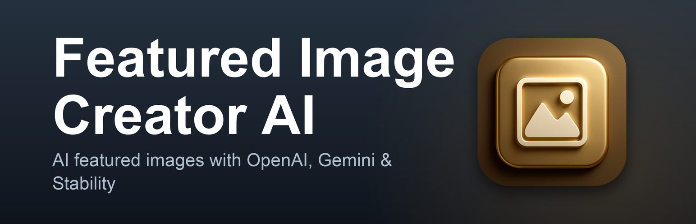

<div align="center">



# 🎨 Featured Image Creator AI

### Give every post a featured image, generated by AI, in your brand's colour, without leaving WordPress.

Bring your own OpenAI, Google Gemini, or Stability AI key and let the plugin do the rest: single posts, whole archives in bulk, style presets, text and logo overlays, social sizes, alt text, and a brand colour that ties the whole blog together.

<br/>

[](https://wordpress.org/plugins/featured-image-creator-ai/)
[](https://wordpress.org/plugins/featured-image-creator-ai/advanced/)
[](https://wordpress.org/support/plugin/featured-image-creator-ai/reviews/)

[](https://wordpress.org/plugins/featured-image-creator-ai/)
[](https://wordpress.org/plugins/featured-image-creator-ai/)
[](https://www.php.net/)
[](https://www.gnu.org/licenses/gpl-2.0.html)

[**Get it on WordPress.org**](https://wordpress.org/plugins/featured-image-creator-ai/) · [**Report a bug**](https://github.com/gunjanjaswal/Featured-Image-Creator-AI/issues) · [**Support the project**](https://ko-fi.com/gunjanjaswal)

</div>

---

## Table of contents

- [What's new in 1.2.0](#-whats-new-in-120)
- [Why you'll like it](#-why-youll-like-it)
- [Features at a glance](#-features-at-a-glance)
- [Supported providers & models](#-supported-providers--models)
- [Installation](#-installation)
- [Quick start](#-quick-start)
- [Using the plugin](#-using-the-plugin)
- [Requirements](#-requirements)
- [Hooks & filters for developers](#-hooks--filters-for-developers)
- [Security & privacy](#-security--privacy)
- [What it costs to run](#-what-it-costs-to-run)
- [FAQ](#-faq)
- [Contributing](#-contributing)
- [Support the project](#-support-the-project)
- [Author](#-author)
- [License](#-license)
- [Changelog](#-changelog)

---

## ✨ What's new in 1.2.0

> The 1.2.x line is all about colour and confidence: make your images match your brand, and know your setup works before you run a batch.

| 🆕 | Feature | What it does |
|----|---------|--------------|
| 🎨 | **Colour Theme** | Pick a brand colour and new images are built around it. The colour is woven into the prompt so every provider leans on it, with an optional **Exact Colour** pass that recolours the finished image locally (Imagick or GD) toward your exact hue. No extra API cost. |
| 🖼️ | **Recolour Existing** | A new tab on the Bulk Generate screen shifts the colours of featured images you *already have* toward your brand colour. The image stays the same, only the colours change, and it runs on your server with no API calls. |
| 🔌 | **Test API Key** | A button on the settings screen checks your saved key against the provider without generating an image, and tells you success or the exact error. Catch a bad key before you run a batch, not after. |
| 🚀 | **Auto-generate on any publish** | A post published with no featured image now gets one even when it's published directly (REST API, quick publish), not only from a draft or a scheduled post. |

Earlier in the 1.1.x line the featured image started refreshing instantly in the block editor, the Bulk Generate button got its visibility back, panels went full width, and the default image size moved to a clean 16:9 **1200×675**.

---

## 💡 Why you'll like it

- **No prompt-writing required.** Pick a style and a colour, hit generate. The post title does the rest.
- **Your key, your costs, your data.** Bring your own API key. It's encrypted before it's stored, and nothing is routed through a middle service.
- **Local where it counts.** Overlays, social crops, and recolouring all happen on your server, so they don't cost API credits and your image data stays put.
- **Scales from one post to a whole archive.** Generate a single featured image from the editor, or run the whole site in the background from one screen.
- **Plays nicely with SEO plugins.** Open Graph images set themselves for Yoast and Rank Math, with a clean fallback when neither is active.

---

## 🧩 Features at a glance

#### 🤖 Generation
- **Three providers, many models** — OpenAI (DALL-E 3 and the GPT Image family), Google Gemini (Imagen), and Stability AI (Stable Diffusion 3, SeeDream).
- **Bring your own API key**, encrypted at rest.
- **Single or bulk** — one post from the editor, or every post in the background.
- **Quality and format control** — Standard / HD / Low on OpenAI, and PNG / JPG / WEBP output.
- **Custom prompt template** with a `{title}` placeholder.
- **Auto-generate on publish** when a post goes live without a featured image.

#### 🎨 Look & feel
- **Style presets** — Photographic, Flat Illustration, Digital Art, 3D Render, Watercolour, Minimal, Isometric, Cyberpunk, Paper-cut, Corporate, Retro. Site default or per-post.
- **Colour Theme** — a brand colour steered into the prompt, with an optional exact-colour recolour pass.
- **Text & logo overlay** — burn an auto-wrapped headline and a logo or watermark onto the image, rendered locally with a bundled Poppins font.

#### 🛠️ Workflow
- **Image variations** — generate several options at once and pick the one you like; the rest are cleaned up.
- **Recolour existing images** in bulk toward your brand colour.
- **Test API Key** button so you know your setup works.
- **Auto alt text** from the provider's vision model, for SEO and accessibility.
- **Social & Open Graph sizes** cropped locally from one image.

---

## 🧠 Supported providers & models

| Provider | Models | Quality options | Output formats |
|----------|--------|-----------------|----------------|
| 🟢 **OpenAI** | DALL-E 3, GPT Image 1, GPT Image 1 (Mini), GPT Image 1.5, GPT Image Latest | Standard, HD, Low | PNG, JPG, WEBP (auto-converted) |
| 🟣 **Stability AI** | Stable Diffusion 3, SeeDream 4.5 | — | PNG, JPG, WEBP (native) |
| 🔵 **Google Gemini** | Imagen | — | PNG |

> 💬 **Auto Alt Text** uses a vision model where one exists — OpenAI (`gpt-4o-mini`) and Gemini describe the image, while Stability AI falls back to the post title.

---

## 📦 Installation

### From your WordPress dashboard (recommended)

1. Go to **Plugins → Add New**.
2. Search for **Featured Image Creator AI**.
3. Click **Install Now**, then **Activate**.

### Manual upload

1. Download the latest ZIP from the [releases page](https://github.com/gunjanjaswal/Featured-Image-Creator-AI/releases) or [WordPress.org](https://wordpress.org/plugins/featured-image-creator-ai/).
2. In WordPress, go to **Plugins → Add New → Upload Plugin** and choose the ZIP.
3. Activate it.

### From source

```bash
git clone https://github.com/gunjanjaswal/Featured-Image-Creator-AI.git
cp -r Featured-Image-Creator-AI /path/to/wordpress/wp-content/plugins/featured-image-creator-ai
```

---

## 🚀 Quick start

1. Open **Featured Image Creator AI → Settings** from the admin menu.
2. Pick your **API Provider** and paste your **API key**:
   - 🟢 OpenAI — [platform.openai.com/api-keys](https://platform.openai.com/api-keys)
   - 🔵 Google Gemini — [aistudio.google.com/app/apikey](https://aistudio.google.com/app/apikey)
   - 🟣 Stability AI — [platform.stability.ai/account/keys](https://platform.stability.ai/account/keys)
3. Save, then click **Test API Key** to confirm the key works. ✅
4. (Optional) Set a **Brand Colour**, a **Style**, and your image size.
5. Edit any post and click **Generate Featured Image**, or run a batch from **Bulk Generate**.

---

## 📖 Using the plugin

<details open>
<summary><strong>🖊️ Generate for a single post</strong></summary>

<br/>

Open any post in the editor and find the **AI Featured Image** box in the sidebar. Click **Generate Featured Image** and it's created and set as the thumbnail. Prefer options? Click **Generate Options** to get a grid, then click your favourite — the others are deleted for you.

</details>

<details>
<summary><strong>📚 Bulk generation</strong></summary>

<br/>

Go to **Featured Image Creator AI → Bulk Generate**. Three tabs:

- **Generate Missing** — covers every published post that has no featured image.
- **Regenerate All** — rebuilds featured images for all posts (overwrites existing ones).
- **Recolour Existing** — shifts the colours of images you already have toward your brand colour, without regenerating them.

Each run shows live progress and a summary of successes and errors. You can also select posts on **Posts → All Posts** and use the **Generate Featured Images** bulk action.

</details>

<details>
<summary><strong>🎨 Colour Theme</strong></summary>

<br/>

Under **Settings → Colour Theme**, turn the theme on and pick a **Brand Colour**. New images are built around that colour through the prompt. Switch on **Exact Colour** to also run a local recolour pass that pushes the finished image toward your precise hue, with an adjustable strength. To update images you already published, use the **Recolour Existing** tab on the Bulk Generate screen — it keeps the composition and only changes the colours, with no API calls.

</details>

<details>
<summary><strong>🖌️ Styles, overlays & variations</strong></summary>

<br/>

- **Styles** — set a default look under settings, or override it from the **Style** dropdown in the editor.
- **Text & Logo Overlay** — enable it, use `{title}` for the headline, and configure font weight, size, colour, position, a readability scrim, and a logo corner. Rendered locally with Imagick or GD.
- **Variations** — set how many options to produce (2–8). Each option uses one API credit.

</details>

<details>
<summary><strong>♿ Alt text & 📣 social images</strong></summary>

<br/>

- **Auto Alt Text** — describe each generated image with the provider's vision model and save it as the attachment's alt text. Stability AI falls back to the post title.
- **Social & Open Graph** — tick the sizes you want (Open Graph 1200×630, Twitter, square 1080×1080, Pinterest 1000×1500). Each is cropped locally from the generated image. With **Open Graph Image** on, the share image is set for Yoast SEO or Rank Math, or output as `og:image` / `twitter:image` tags when no SEO plugin is active.

</details>

---

## ✅ Requirements

| | |
|---|---|
| **WordPress** | 5.8 or higher |
| **PHP** | 7.4 or higher |
| **API key** | OpenAI, Google Gemini, or Stability AI |
| **`openssl`** | Required — encrypts your API key |
| **`imagick` or `gd`** | Needed for overlays and the colour recolour pass |

---

## 🧑‍💻 Hooks & filters for developers

Everything below is a real hook shipped by the plugin.

### Filters

```php
// Add or change style presets ( key => ['label' => ..., 'suffix' => ...] ).
add_filter( 'aifig_style_presets', function ( $presets ) {
    $presets['my_brand'] = array(
        'label'  => 'My Brand Look',
        'suffix' => 'Bold brand colours, clean layout, on-brand illustration style.',
    );
    return $presets;
} );

// Add or change social / Open Graph sizes ( key => ['label', 'width', 'height'] ).
add_filter( 'aifig_social_variants', function ( $specs ) {
    $specs['story'] = array( 'label' => 'Story (1080×1920)', 'width' => 1080, 'height' => 1920 );
    return $specs;
} );

// Pick the vision models used for Auto Alt Text.
add_filter( 'aifig_openai_vision_model', fn() => 'gpt-4o-mini' );
add_filter( 'aifig_gemini_vision_model', fn() => 'gemini-2.0-flash' );

// Opt in to routing through WordPress 7.0's core AI Client (off by default).
add_filter( 'aifig_use_wp_ai_client', '__return_true' );
```

### Actions

```php
// Fires after an auto-generation attempt on publish.
// $result is an attachment ID on success or a WP_Error on failure.
add_action( 'aifig_auto_generate_result', function ( $result, $post_id ) {
    if ( is_wp_error( $result ) ) {
        error_log( "AIFIG failed for post {$post_id}: " . $result->get_error_message() );
    }
}, 10, 2 );
```

---

## 🔒 Security & privacy

- API keys are encrypted with **AES-256-CBC** before they're stored.
- Inputs are sanitised and validated; AJAX requests are nonce-checked; admin actions run capability checks.
- Post titles are sent to your chosen provider to generate the image. With **Auto Alt Text** on (off by default), the generated image is also sent to that provider's vision model for a description.
- Overlays, social crops, and the colour recolour pass are **processed locally** — no image data leaves your server for those steps.

Provider policies: [OpenAI](https://openai.com/policies/) · [Google](https://policies.google.com/privacy) · [Stability AI](https://stability.ai/privacy-policy)

---

## 💸 What it costs to run

You pay your provider directly for generation. Rough guide (check current pricing):

| Provider | Approx. cost | Pricing |
|----------|--------------|---------|
| OpenAI DALL-E 3 | ~$0.04 standard / ~$0.08 HD per image | [openai.com/pricing](https://openai.com/api/pricing/) |
| Stability AI | ~$0.04 per image | [platform.stability.ai/pricing](https://platform.stability.ai/pricing) |
| Google Gemini | Free tier, then usage-based | [ai.google.dev/pricing](https://ai.google.dev/pricing) |

> 🟢 Overlays, social sizes, and recolouring are done locally and **never** add to your API bill.

---

## ❓ FAQ

<details>
<summary><strong>If I change the brand colour, does it recolour my existing images?</strong></summary>

<br/>

No — changing the setting only affects newly generated images. To recolour images you already have, use the **Recolour Existing** tab on the Bulk Generate screen. It keeps each image the same and only shifts the colours.
</details>

<details>
<summary><strong>Generation fails with an "Incorrect API key" / HTTP 401 error.</strong></summary>

<br/>

Your saved key is wrong or expired. Open **Settings**, paste a fresh key, save, and click **Test API Key** to confirm it before running anything.
</details>

<details>
<summary><strong>Do overlays or social images use extra API credits?</strong></summary>

<br/>

No. They're cropped and rendered on your own server with Imagick or GD.
</details>

<details>
<summary><strong>Which image size does it use?</strong></summary>

<br/>

The default is **1200×675** (16:9). You can change it under **Settings → Image Settings**.
</details>

---

## 🤝 Contributing

Pull requests are welcome.

1. Fork the repo.
2. Create a branch: `git checkout -b feature/your-idea`.
3. Commit your changes.
4. Push and open a PR.

The code follows the [WordPress Coding Standards](https://developer.wordpress.org/coding-standards/wordpress-coding-standards/):

```bash
composer global require "squizlabs/php_codesniffer=*"
phpcs --standard=WordPress .
phpcbf --standard=WordPress .   # auto-fix
```

---

## ❤️ Support the project

If this plugin saves you time, a coffee goes a long way toward keeping it maintained.

<div align="center">

[](https://ko-fi.com/gunjanjaswal)

</div>

- 🐛 **Found a bug?** [Open an issue](https://github.com/gunjanjaswal/Featured-Image-Creator-AI/issues)
- 💬 **Need help?** [WordPress.org support forum](https://wordpress.org/support/plugin/featured-image-creator-ai/)
- ⭐ **Like it?** [Leave a review](https://wordpress.org/support/plugin/featured-image-creator-ai/reviews/)

---

## 👤 Author

**Gunjan Jaswal**

[](https://gunjanjaswal.me)
[](mailto:hello@gunjanjaswal.me)
[](https://github.com/gunjanjaswal)

---

## 📄 License

Released under the **GPL v2 or later**.

```
Featured Image Creator AI
Copyright (C) 2024–2026  Gunjan Jaswal

This program is free software; you can redistribute it and/or modify
it under the terms of the GNU General Public License as published by
the Free Software Foundation; either version 2 of the License, or
(at your option) any later version.

This program is distributed in the hope that it will be useful,
but WITHOUT ANY WARRANTY; without even the implied warranty of
MERCHANTABILITY or FITNESS FOR A PARTICULAR PURPOSE. See the
GNU General Public License for more details.
```

Bundled **Poppins** font is used under the [SIL Open Font License](https://scripts.sil.org/OFL).

---

## 🗒️ Changelog

### 1.2.4
- Tested and confirmed compatible with WordPress 7.1.4.

### 1.2.3
- Fixed the "Regenerate All Images" button (and the Generate/Recolour buttons) blending into the purple banner behind it. The button is now solid white with purple text, so it clearly reads as a button.
- Fixed the "GPT Image Latest" model option failing to generate. OpenAI has no model called "latest", so picking it returned an error. It now maps to the current GPT Image model, and sites already set to it are fixed automatically on update.

### 1.2.2
- Every site now defaults to a 1200x675 (16:9) image size. New installs already started there; on update, existing sites that were still on the old 1024x675 size (or any other saved size) are moved to 1200x675 once. You can still change the size afterward under Settings, and your choice sticks.

### 1.2.1
- **New: Per-category colours.** On top of the global Colour Theme, you can now assign a brand colour to individual categories. Posts in a category with its own colour are built around that colour instead of the site-wide one, so a "News" section can run blue while "Recipes" runs green. Posts in a category without a rule keep using the global colour, and a per-post override still beats everything.

### 1.2.0
- **New: Colour Theme.** Pick a brand colour under Settings and new images are built around it. The colour is woven into the generation prompt so every provider leans on it, with an optional "Exact Colour" toggle that recolours the finished image locally (Imagick or GD) toward your exact hue at an adjustable strength. No extra API cost.
- **New: Recolour existing images.** A "Recolour Existing" tab on the Bulk Generate screen shifts the colours of featured images you already have toward your brand colour. The image stays exactly the same, only the colours change, and it runs on your server with no API calls.
- **New: Test API Key button.** On the settings screen, check your saved key against the provider without generating an image. It reports success or the exact error, so a wrong key is caught before you run a batch.
- Auto-generate on publish now also covers posts published directly from new (for example via the REST API or quick publish), not only drafts and scheduled posts. A post published without a featured image still gets one.

### 1.1.3
- Fixed the "Generate All Images" button on the Bulk Generate screen showing up invisible against the purple banner. It was falling back to WordPress's default button styling instead of the plugin's own, so the label and border washed out and you could barely see it.
- The progress and results panels on the Bulk Generate screen now run the full width of the page and sit centered, instead of being squeezed into a narrow card.
- Default image size is now 1200x675 (a clean 16:9) instead of 1024x675. Sites that already have a size saved keep it; this only changes the default for new installs.

### 1.1.2
- The featured image now appears straight away in the block editor after you generate or pick one. It was only ever refreshing the classic editor's featured image box, which the block editor does not have, so the sidebar sat there looking empty until you reloaded the page even though the image had saved fine.
- Tidied up a nonce check that a code scanner was reading as missing. The check was always there, the annotation around it just did not cover every line.

### 1.1.1
- Fixed an OpenAI "HTTP 400: Invalid value: 'standard'" error when generating with the GPT Image models. The quality setting is now mapped to each model's accepted values — DALL-E 3 uses Standard/HD, while GPT Image models use Low/Medium/High/Auto (Standard maps to Medium, HD to High).

### 1.1.0
- **New: Style Presets.** Pick a ready-made look (Photographic, Flat Illustration, Digital Art, 3D Render, Watercolor, Minimal, Isometric, Cyberpunk, Paper-cut, Corporate, Retro) as a site default or per post — no prompt engineering required. Extendable via the `aifig_style_presets` filter.
- **New: Text & Logo Overlay.** Burn an auto-wrapped headline (the post title by default) and/or a logo/watermark directly onto generated images. Configurable font weight, size, color, vertical position, readability scrim (gradient/dark/light) and logo corner + size. Renders locally with Imagick or GD using a bundled Poppins (SIL OFL) font.
- **New: Image Variations.** Generate multiple options at once from the editor and choose your favorite from a grid; unchosen images are deleted automatically. Count is configurable (2–8).
- **New: Auto Alt Text.** Optionally describe each generated image with the provider's vision model (OpenAI `gpt-4o-mini` / Gemini) and save it as the attachment alt text for SEO and accessibility. Falls back to the post title for providers without vision. Models are filterable (`aifig_openai_vision_model`, `aifig_gemini_vision_model`).
- **New: Social & Open Graph Images.** Generate Facebook/Open Graph (1200×630), Twitter/X, square (1080×1080) and Pinterest (1000×1500) sizes from each generated image. Cropping is done locally — no extra API credits. Optionally sets the Open Graph share image for Yoast SEO and Rank Math, with an `og:image` / `twitter:image` fallback when no SEO plugin is active. Sizes are extendable via the `aifig_social_variants` filter.
- **New: "How to use" guide** added to the settings screen and the documentation, covering styles, overlays, variations, alt text and social images.
- **New: "What's New" panel** shown once after updating the plugin, summarizing the latest features. It is dismissible per user and never appears on a fresh install.
- Refactored the generator into reusable attachment/variation/alt-text steps; all generation paths (single, bulk, scheduled auto-publish) share the new style, overlay and social handling. Social variants are cleaned up and regenerated whenever the featured image changes.

### 1.0.6
- WordPress 7.0 integration:
  - Iframed editor: documented the meta-box-only integration. The meta box renders in the parent admin chrome (not the editor iframe), so no asset changes were required.
  - AI Client API: added `aifig_is_wp_ai_client_available()` (uses core `wp_supports_ai()` + `wp_ai_client_prompt()`) and `aifig_wp_ai_client_prompt()` helpers. Routing through the core client is opt-in via the `aifig_use_wp_ai_client` filter; bundled OpenAI / Gemini / Stability providers remain the default image-generation path.
  - Connectors API: registers an `ai_provider` connector on the `wp_connectors_init` action so the encrypted `aifig_api_key` option surfaces on the central Connections screen alongside core's auto-discovered providers. Falls back silently on WP 6.x.

### 1.0.5
- Updated "Tested up to" to WordPress 7.0.
- Replaced Buy Me a Coffee donation link with Ko-fi (https://ko-fi.com/gunjanjaswal).
- Added "Contact Developer" link to plugin row meta on the Plugins screen.
- Replaced raw error_log() calls on scheduled-publish auto-generate with a new `aifig_auto_generate_result` action hook so site owners can log results themselves.
- Corrected GitHub repository slug in Documentation row-meta link.

### 1.0.4
- Fixed fatal error by requiring file.php before calling wp_tempnam() in OpenAI provider

### 1.0.3
- Enable Output Format selection (PNG/JPG/WEBP) for OpenAI models (images are automatically converted)
- Updated documentation with full list of supported models and options
- Improved compatibility with GPT Image 1 (Mini)

### 1.0.2
- Added new image generation models: GPT Image 1, GPT Image 1 (Mini), GPT Image 1.5, GPT Image Latest
- Added SeaDream 4.5 support for Stability AI
- Added image quality settings (Standard/HD/Low) and output format selection (PNG/JPG/WEBP)
- Added Bulk Regeneration feature to regenerate images for all posts
- Fixed image dimension error for custom models
- Improved code quality and security (nonces, escaping)

### 1.0.1
- Added automatic featured image generation for scheduled posts
- Fixed author name spelling
- When a scheduled post is published without a featured image, one is automatically generated

### 1.0.0
- Initial release
- OpenAI DALL-E 3 integration
- Google Gemini (Imagen) integration
- Stability AI (Stable Diffusion 3) integration
- Single post image generation
- Bulk generation for posts without featured images
- Customizable prompt templates
- Encrypted API key storage
- WordPress.org standards compliance

